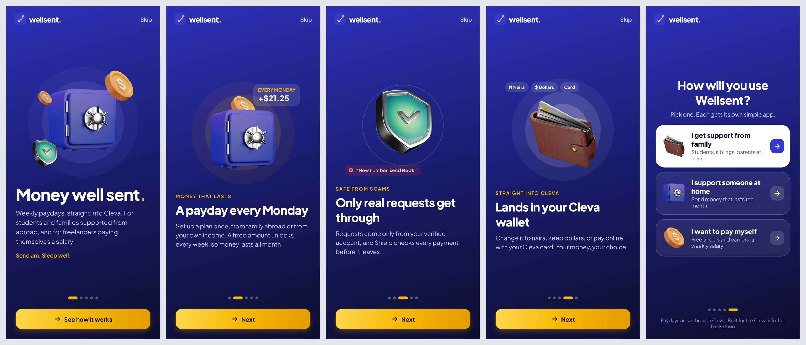
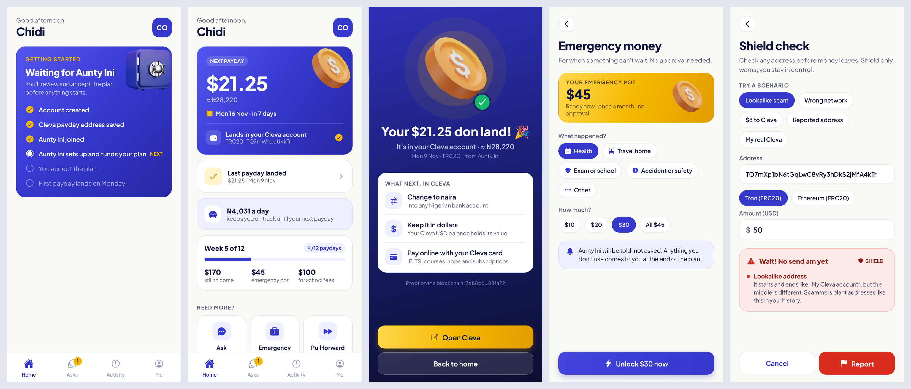
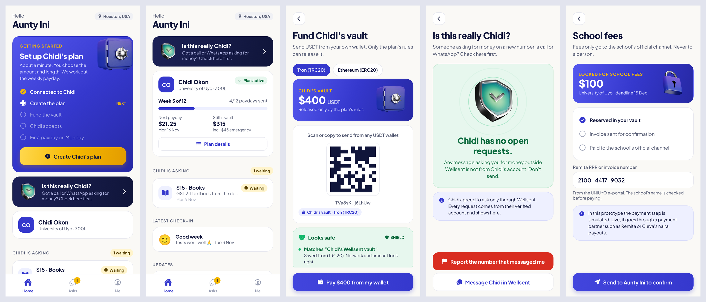
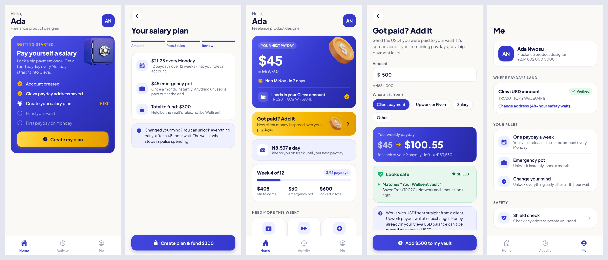

# Wellsent: money well sent.

**Money that lasts and arrives safely, for students and families supported from
abroad, and for freelancers paying themselves a salary.**
Built for the **Cleva × Tether Future of Payments Hackathon (UNIUYO Edition)**.

Someone funds an **Upkeep Vault** in USDT: a family member abroad for a student
or relative, or a freelancer for themselves. It unlocks a weekly payday that
lands straight in the person's **Cleva** account, keeps school fees aside for
the school's official channel, and only accepts money requests from inside the
app. **Shield** checks every payment before money leaves.

## Who it's for

| Who | What they do with Wellsent | In the prototype |
|---|---|---|
| Students supported by family | Weekly paydays, fees paid to the school, asks only in the app | Yes (the main demo) |
| Families supporting anyone at home | The same plans for siblings, parents, apprentices | Same app |
| Freelancers and remote workers | Lock a client payment, get a weekly salary in Cleva, add income any time | Yes ("I want to pay myself") |
| Organisations | Stipends that arrive on time and can be checked | Next |

Students come first because the pain is sharpest. Freelancer plans work with
income received in USDT; money already in a Cleva USD balance can't be sent
back out as USDT.

> USDT carries the rules. Cleva is the student's bank.






## What it solves

| Problem | Wellsent |
|---|---|
| Allowance arrives as a lump sum, gone by week 2 | Weekly paydays + a daily pace |
| Naira loses value while money sits | Stays in dollars until the student converts in Cleva |
| "Mummy, it's me, new number" scams | Verified Asks: requests only come through the app |
| School-fee fraud | Fees go only to the school's official channel, with a receipt |
| Emergencies | Emergency pot the student unlocks instantly (sponsor told, not asked) |
| Lookalike addresses, wrong networks, sub-$10 Cleva deposits | Shield warns before sending |

## How it uses Cleva

1. Every student signs up on Cleva (code **UNIUYO**) and verifies identity.
2. The student saves their Cleva USDT deposit address once (TRC20 or ERC20).
3. Every payday is sent to that address; Cleva converts it 1:1 to USD.
4. The student changes it to naira, keeps dollars, or uses the Cleva dollar card.
5. Shield enforces Cleva's deposit rules: never under $10, always the saved network.

Proposed with a Cleva partnership: "Verified by Cleva" identity badges, sponsor
funding through Cleva's licensed inbound-transfer rails, and Fees Direct via Cleva
naira payouts.

## The app (`mobile/`)

React Native (Expo SDK 51). Brand: indigo `#3538CD`, ink `#10153A`, payday gold
`#F5B800` (money moments only), Plus Jakarta Sans. Green/orange/red are reserved
for Shield verdicts. Brand gradients (`GRAD` in `src/components/Brand.js`) paint
onboarding, hero cards and primary buttons.

3D objects live in `mobile/assets/3d/` (vault, padlock, coin, wallet, shield).
The vault and padlock were recoloured from red to brand indigo, since red means
danger in this app. Motion uses React Native's Animated API (floating objects,
parallax onboarding, coin drop, Shield shake) and `expo-haptics`, and switches
off when the phone's Reduce Motion setting is on.

```bash
cd mobile
npm install
npm start          # Expo Go on your phone
npm run web        # in a browser
npm test           # Shield + plan-rule tests
```

The prototype runs fully on-device with demo data: one phone can play the
student, the sponsor or a freelancer (**Me → Demo controls**), and **Run payday**
fast-forwards to Monday. On web, `?demo=student`, `?demo=sponsor` or
`?demo=self` opens a plan already under way, and `&screen=Name` opens a
specific screen.

### Screens

- **Shared:** Onboarding story (4 swipeable pages + role choice) · Sign up ·
  Connect Cleva · Pair (invite code) · Shield check. Setup screens show
  "Step X of Y"; both homes show a Getting Started checklist until the plan is live.
- **Student:** Home (next payday, daily pace, progress) · Plan invite (5 promises) ·
  Payday landed · Asks · New ask · Emergency · Pull forward · School fees ·
  Weekly check-in · Activity · Me
- **Freelancer ("pay myself"):** Home (next payday, "Got paid? Add it") ·
  Create salary plan (3 steps) · Fund vault · Add income · Emergency · Pull forward · Me
- **Sponsor:** Home ("Is this really Chidi?") · Create plan (4 steps) · Fund vault ·
  Asks · Ask detail · Scam check · Plan detail · Me

### Plan rules (`src/state/planMath.js`, tested)

- At most 26 weeks (one semester); the app computes the payday so nothing is stranded.
- Every payday is at least $10 (Cleva's minimum); small plans switch to fortnightly.
- Emergency pot (default 15%) unlocks once a month without approval.
- Pull forward up to 2 paydays a month; later paydays shrink but never below $10.
- Reductions/cancellation need 2 weeks' notice; leftovers go to the student.

### Shield (`src/shield/shield.js`, tested)

Pure rules: invalid address, wrong network, lookalike of a saved address,
community-reported address, under Cleva's $10 minimum, and a caution for large
first payments. Changing the payday address needs sponsor confirmation and a
48-hour wait. Note: address checks are format-only; production should also
verify address checksums.

## Status

- **Done:** full UI and demo flows for students, sponsors and freelancers, plan
  rules, Shield rules, tests.
- **Simulated in the demo:** the vault contract, real USDT transfers, Cleva
  deposits, and Fees Direct payment.
- **Next:** vault smart contract (Tron/Ethereum, the networks Cleva accepts),
  WDK wallets, a real $10+ USDT deposit into Cleva for the pitch, and a backend
  for plans/asks so two phones stay in sync.

`backend/` still holds the earlier Savi API (Node/Express/MongoDB) from before
the pivot; it is not used by the Wellsent app yet.
